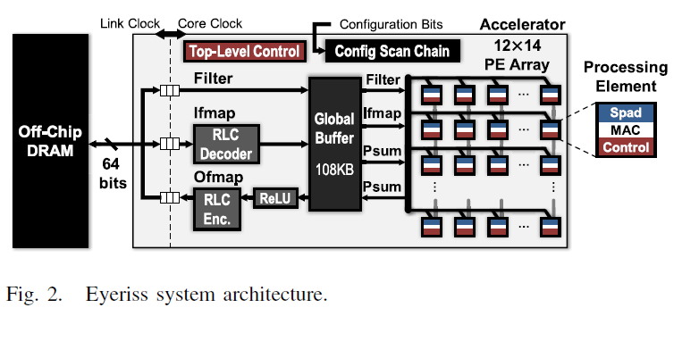
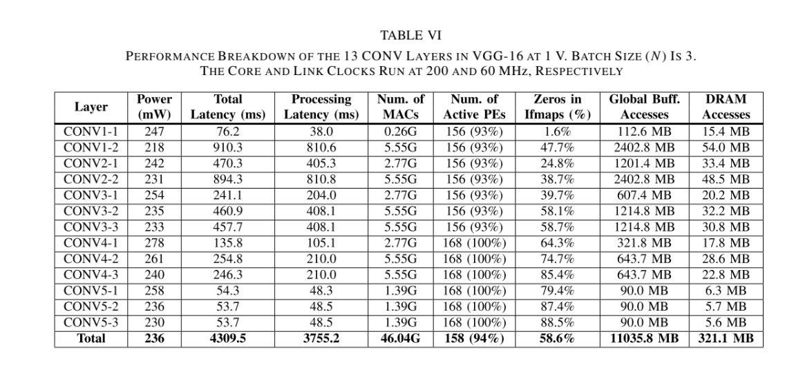
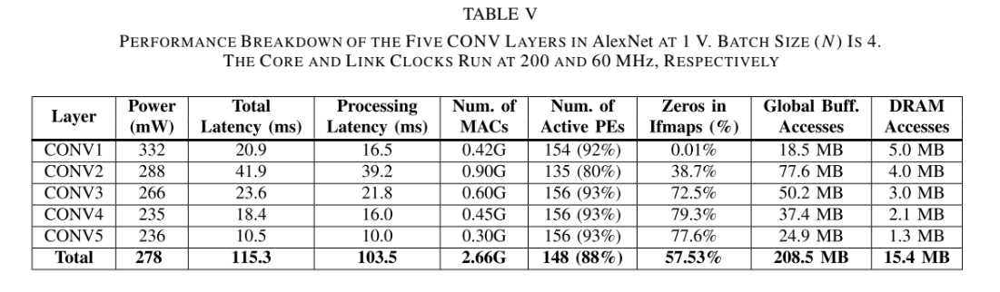

The paper title: 
* Eyeriss: An Energy-Efficient Reconfigurable Accelerator for Deep Convolutional Neural Networks

* Overview of Eyeriss architecture *  
The features of Eyeriss include: 
** spatial architecture with 168 PE 
** 4 levels of memory hierachies:DRAM, GLB, inter-PE and spads -  optimizing on low levels such as scratpads and inter communication, minimizing to the
                                on chip global buffer (GLB) and the off-chip DRAM
** The row stationary (RS) dataflow
** Network-on-chip (NoC) to support RS by multicast and point-to-point data delivery
** Run length compression (RLC) and PE gating to exploit zero data points

eyeriss-architecture (Chen et al.,p. 2)
** There are 2 clocks domains:
    *** The core clock: consisting the spatial array of 168 PEs into 12 * 14 rectangle + 108 kB GLB + RLC CODEC + ReLU module
            **** 108 kB GLB: for AlexNet image input size is 227 * 227 * 3 -> the total value = 154587 values
            assuming Eyeriss is standard 8-bits precision  -> 154587 * 8 = 1.256.696 bits = 154.587 bytes = 151 KB
    *** The link clock domain: to comunicate with off-chip DRAM through 64-b bidirectional data bus
** The 2 domains run independently and communicate thorugh an FIFO interface
** Each PE can communicate with its neighbor PEs or GLC through NoC, or spads for transfering data

** System control** 
There are 2 levels of control hierarchy
A. top level
    1. traffic betwen DRAM and GLB through FIFO interface
    2. traffic beweetn GLB and PE array through NOC
B. low level
    The operation of RLC CODEC and ReLU mmodule: consists control logic in each PE running independently. 168 PEs are identical, running under the core clock, but can start its own processing once fmap or psum arrives => the PE do not process in lock steps

Notation:
    N : batch size of 3D fmaps
    M : # of 3D filters/ # of ofmap channels
    C : # of ifmap/filter channels
    H/W : ifmap plane height/ width
    R/S : filter plane height/ width
    E/F : ofmap plane height/width

* Energy-efficient features* 
A. Dataflow: RS
RS minimizes movements of ifmap, filter and psums
Data access to DRAM and GLB are minimized
Maximally reuse data from spads and inter-PE communication
The goal:
    Convolutional reuse: 
        Each filter weights is reused E x F times in the same ifmap plane
        Each ifmap pixel is reused R X S times in the same filter plane
    Filter reuse: 
        Each filter weight is reused across batch of N ifmaps
    Ifmap reuse:
        Each ifmap pixel is reuse across M filters (to generate M ofmap channels)

The trade off: 
    To minimize psums' movement, the psum accumulation shall be done asap across C x R x S to save storage and memory R/W energy
    However, maximum input reuse forces the system to proceed with input data immediate = using the same filter or ifmap values -> missing values for psum MAC
    => Conflict, both goals cannot be achieved simmuataneouly 
        => RS approaches this dilenma by using convolution primitve in PEs

Convolution Primitive in PEs
    1-D Convolution Primitive in a PE: 
        Each PE is assign to process with 1 primitive
        Each primitive operates 1 row of filter weights AND 1 row of ifmap values, AND generates 1 row of psums
        The compuation stay stationary in PE and use local spads for convolution data reuse and psum accumulation
        The size of spad capacity depends on:
            S for a row of filter weights
            S for a sliding window of ifmap values
            1 for psum accumulation
            

* Benchmark*
** 1000-class image classification on the ImageNet data set
** AlexNet and VGG-16

** VGG -16 
PERFORMANCE BREAKDOWN OF THE 13 CONV LAYERS IN VGG-16 AT 1 V. BATCH SIZE (N) IS 3.

** AlexNet 
PERFORMANCE BREAKDOWN OF THE FIVE CONV LAYERS IN AlexNet AT 1 V. BATCH SIZE (N) IS 4.

